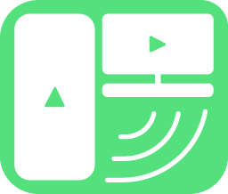

  

  # ScrcpyDock

  **Panel Kontrol Desktop Ringan & Studio Auto-Docking untuk Scrcpy & Android ADB**

  
  
  
  

   

  [English](README.md) • [Bahasa Indonesia](README_ID.md) • [Unduh Rilis](https://github.com/Mufe3/ScrcpyDock/releases) • [Laporkan Masalah](https://github.com/Mufe3/ScrcpyDock/issues)

---

## ⚡ Mengenal ScrcpyDock

**ScrcpyDock** adalah aplikasi pengendali grafis (GUI) modern untuk [Genymobile/scrcpy](https://github.com/Genymobile/scrcpy). Dibuat menggunakan **engine native C++ Flutter Desktop**, ScrcpyDock secara otomatis menempel rapi (*auto-docking*) di sebelah jendela layar ponsel Android kamu di Windows. Kamu dapat mengontrol kualitas layar, audio, mikrofon HP, perekam makro otomatis, hingga koneksi Wi-Fi nirkabel tanpa perlu mengetik satu pun perintah CMD/terminal.

Berbeda dengan aplikasi GUI lain yang berbasis web/Electron yang memakan RAM besar hingga ratusan megabyte, ScrcpyDock sangat ringkas (ukuran paket portabel hanya ~20 MB), terbuka instan dalam sekejap, dan hanya menggunakan memori RAM di bawah 80 MB.

---

## 📊 Perbandingan: Mengapa Memilih ScrcpyDock?

| Fitur / Parameter | **ScrcpyDock** | **Escrcpy** (Electron) | **Scrcpy Bawaan** (CLI) |
| :--- | :---: | :---: | :---: |
| **Ukuran Download / File** | **~20 MB** (Portabel) | ~145 MB | ~15 MB |
| **Penggunaan Memori (RAM)** | **~70 – 90 MB** | 350 – 500 MB | ~50 MB |
| **Kecepatan Membuka** | **Instan (< 0.5 detik)** | 2 – 4 detik | Instan |
| **Sistem Auto-Docking** | ✅ **Menempel rapi di samping HP** | ❌ Jendela kaku | ❌ Tidak ada |
| **Mode Lipat Ramping (48px)**| ✅ **Bisa dilipat satu klik** | ❌ Tidak ada | ❌ Tidak ada |
| **Perekam Makro Bawaan** | ✅ **Visual Recorder + Loop** | ⚠️ Script manual | ❌ Tidak ada |
| **Pemindai Wi-Fi (Port 5555)** | ✅ **Pindai otomatis satu klik** | ✅ Ada | ❌ Perintah manual |
| **Studio Mic & Visualizer** | ✅ **Waveform gelombang suara** | ⚠️ Terbatas | ❌ Hanya flag CLI |
| **Lisensi & Kebebasan** | 🟢 **100% Bebas & Open Source (MIT)** | ⚠️ Menuju lisensi berbayar | 🟢 Bebas (Apache 2.0) |

---

## ✨ Fitur Unggulan

### 🎛️ 1. Pengendali Ponsel Lengkap
- Tombol navigasi cepat: Kembali (Back), Beranda (Home), Pindah Aplikasi (App Switcher), Volume Suara, Power, dan Panel Notifikasi.
- Matikan layar HP saat mirroring tetap aktif di monitor PC (hemat baterai & suhu HP tetap dingin).
- Sinkronisasi Clipboard: Kirim teks panjang dari PC langsung ke input HP.
- Tangkapan layar (*Screenshot*) dan rekam video (*MP4*) langsung tersimpan rapi di folder PC.

### 📐 2. Kualitas Tampilan & Streaming
- Preset resolusi instan: Asli Full HD, 1080p, 720p, 480p, atau tentukan lebar/tinggi kustom.
- Pengaturan Framerate: 30 FPS, 60 FPS, 90 FPS, hingga 120 FPS untuk kebutuhan gaming.
- Bitrate dinamis: Geser slider mulai dari 2 Mbps hingga 32 Mbps.
- Dukungan Codec Video: H.264, H.265 (HEVC), dan AV1.

### 🎙️ 3. Studio Audio & Mikrofon
- Teruskan audio sistem Android langsung ke headphone/speaker komputer tanpa delay.
- Injeksi mikrofon PC ke HP: Gunakan mic PC kamu seolah-olah mic headset di HP.
- Dilengkapi visualizer gelombang audio (*live waveform*) yang dinamis.

### 🤖 4. Studio Otomatisasi Makro
- Rekam sentuhan, usapan (*swipe*), klik, dan jeda waktu langsung dari layar HP.
- Simpan rekaman makro dalam file JSON yang dapat digunakan berulang kali.
- Atur kecepatan putar (0.5x, 1x, 2x, 5x, 10x) dan jumlah pengulangan (*loop*).
- Multi-Device Runner: Jalankan makro yang sama ke banyak HP sekaligus secara bersamaan!

### 📡 5. ADB Nirkabel & Manajemen Perangkat
- Pindai jaringan lokal secara otomatis untuk menemukan port ADB Wi-Fi `5555`.
- Generator barcode QR pairing untuk Android 11+.
- Ganti perangkat aktif dengan indikator titik status koneksi hijau real-time.

---

## 🚀 Panduan Memulai Cepat (Portabel, Tanpa Instalasi)

ScrcpyDock sudah dilengkapi dengan binari resmi `scrcpy`, `adb`, dan codec DLL FFmpeg.

1. Unduh file **`ScrcpyDock-v1.0.0-windows-x64.zip`** dari halaman [Releases](https://github.com/Mufe3/ScrcpyDock/releases).
2. Ekstrak file zip ke folder mana saja di komputer kamu (contoh: `D:\ScrcpyDock`).
3. Aktifkan **USB Debugging** di ponsel Android kamu:
   - Buka `Pengaturan > Tentang Ponsel` lalu ketuk **Nomor Bentukan (Build Number)** sebanyak 7 kali.
   - Buka menu `Opsi Pengembang (Developer Options)` dan aktifkan **USB Debugging**.
4. Buka **`scrcpy_premium_panel.exe`** (ScrcpyDock) dan klik tombol biru **Mulai Mirroring**!

---

## ⌨️ Tombol Pintas (*Hotkeys*)

| Tombol | Aksi |
| :--- | :--- |
| **`Alt + D`** | Buka/Tutup Mini-Dock (Lipat ke ukuran 48px) |
| **`Alt + P`** | Tombol Power (Kunci / Nyalakan layar) |
| **`Alt + B`** | Tombol Kembali (Back) |
| **`Alt + H`** | Tombol Beranda (Home) |
| **`Alt + S`** | Buka Recent Apps / App Switcher |
| **`Alt + O`** | Matikan layar fisik HP (Mirroring PC tetap berjalan) |

---

## 💖 Dukung Pengembang

Jika ScrcpyDock mempermudah aktivitas harian, pekerjaan, atau streaming kamu, dukung pengembangannya melalui:

  
  &nbsp;&nbsp;
  
  &nbsp;&nbsp;
  

---

## 📜 Lisensi & Penghargaan

- **Scrcpy**: Didukung oleh mesin hebat [Genymobile/scrcpy](https://github.com/Genymobile/scrcpy) karya Romain Vimont.
- **Engine**: Dibangun menggunakan [Flutter Desktop](https://flutter.dev).
- **Lisensi**: Dirilis di bawah lisensi resmi [MIT License](LICENSE).
